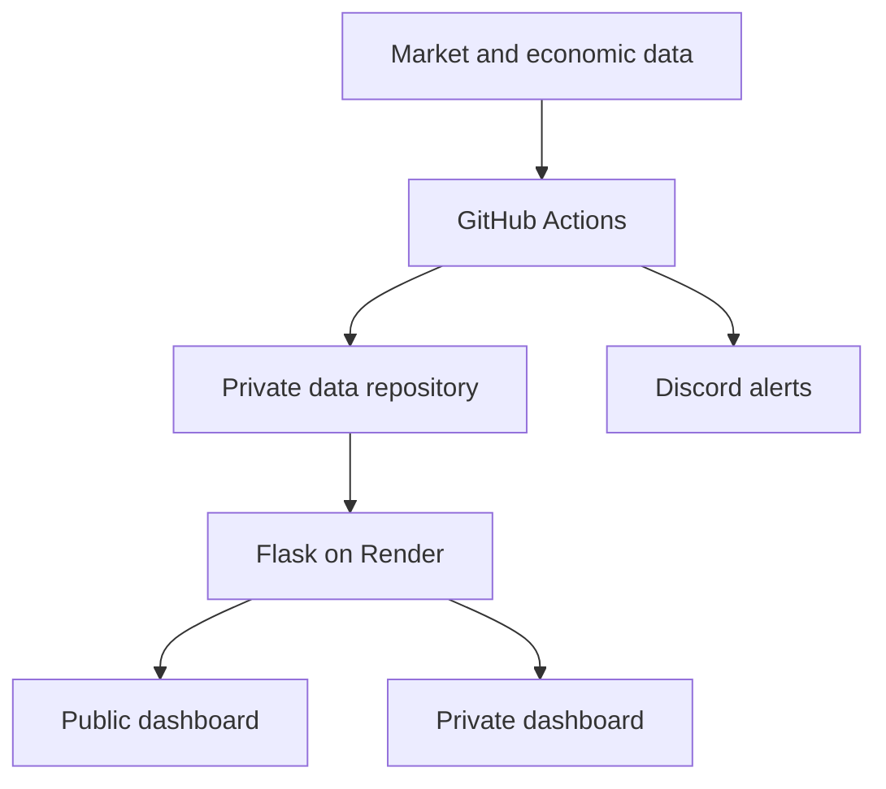

# StockAlerts

StockAlerts is a portfolio dashboard and market monitoring tool I built to understand what drives my portfolio’s returns and automate market monitoring. It uses Python, Flask, and GitHub Actions to collect market data, compare returns with SPY, and send price and valuation alerts through Discord.

**[Open the public demo](https://stock-alerts-9w0q.onrender.com/public)** · [Maintainer guide](docs/maintainer-guide.md) · [Test workflow](.github/workflows/tests.yml)

## Explore the demo

The public dashboard opens without an account.

| View | What to try |
| --- | --- |
| **Holdings** | Start with **Portfolio vs. S&P 500 (SPY)**. Change the period or display currency, then scroll to **Performance Drivers** to see which positions contributed to the return. |
| **Watchlist** | Compare prices and valuation multiples with their configured targets. |
| **Research** | Find my own research notes and a curated reading list, with links to the original articles. |

The benchmark comparison uses matching dates and price returns. The portfolio series excludes cash and dividends. See the [performance methodology](docs/maintainer-guide.md#performance-methodology) for the full calculation assumptions.

## How it works

GitHub Actions prepares market data and dashboard snapshots. Flask reads the snapshots and portfolio records server-side and serves a public dashboard alongside a private view for managing trades, alerts, and research entries. Alert workflows check price and valuation targets and send matching notifications to Discord.



### Implementation decisions

- **Align portfolio and benchmark dates.** The [public analytics module](web/public_analytics.py) calculates the price-return series on matching observations. [Performance Drivers](web/performance_drivers.py) uses historical holdings, including positions sold during the period, and checks that contributions reconcile to the displayed return before publishing them.
- **Prepare data before it is requested.** The [snapshot workflow](.github/workflows/dashboard_snapshots.yml) moves recurring data preparation out of page requests. Quote dates and missing observations help readers judge the data they are seeing.
- **Select what is published.** The [public account projection](web/account_public.py) exposes selected fields such as tickers and allocation percentages. Position quantities and account values stay in the private data repository. [Privacy regression tests](tests/test_public_trade_privacy.py) cover the public trade view.

## Run the tests

Run these commands from the repository root with Python 3.11 and Node.js installed.

```text
python -m pip install -r web/requirements.txt
python -m unittest discover -s tests -v
node --test tests/drivers_ui.test.cjs tests/research_ui.test.cjs tests/watchlist_render.test.cjs
```

The tests use mocked services and synthetic account fixtures. [GitHub Actions](.github/workflows/tests.yml) runs the Python and JavaScript suites on pushes and pull requests.

For the full app, follow the [setup and deployment instructions](docs/maintainer-guide.md#setup) to configure your own private data repository, dashboard, and alerts.

StockAlerts is a personal monitoring and research project. Market data may be delayed or incomplete.
