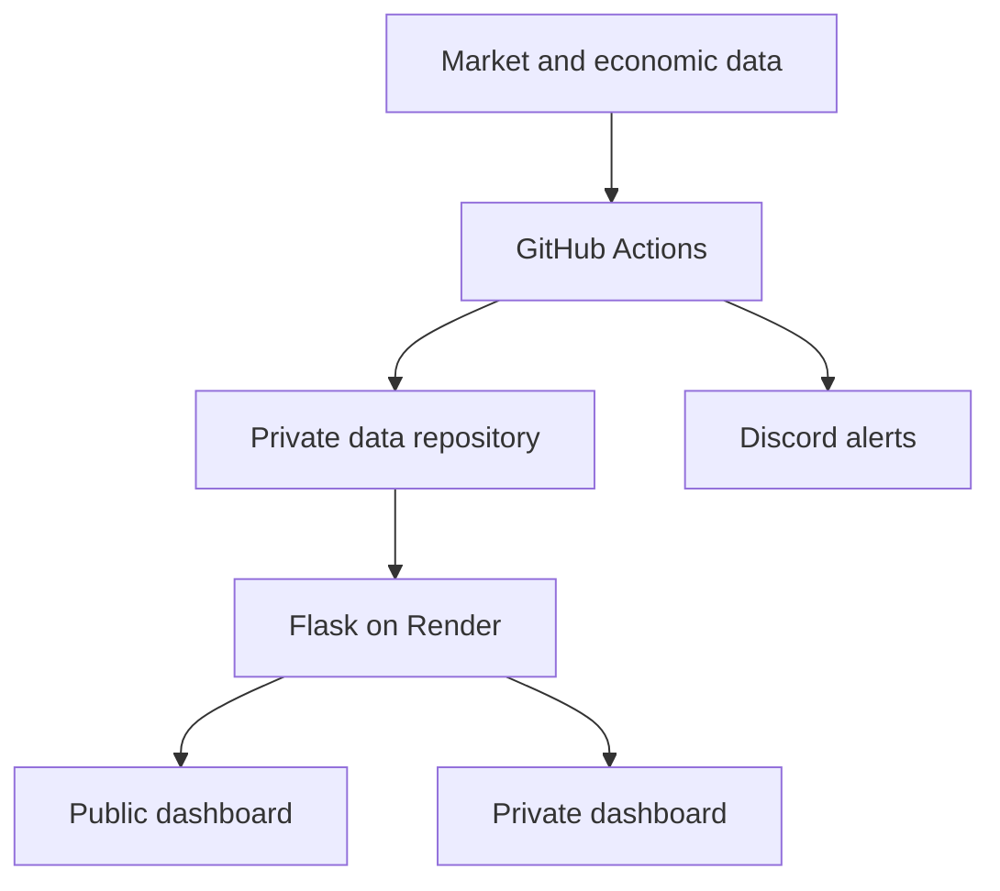

# StockAlerts

StockAlerts is a portfolio dashboard and market monitoring tool I built to understand what drives my portfolio’s returns and automate market monitoring. It uses Python, Flask, and GitHub Actions to collect market data, compare returns with SPY, and send price and valuation alerts through Discord.

**[Open the public demo](https://stock-alerts-9w0q.onrender.com/public)** · [Maintainer guide](docs/maintainer-guide.md)

## Explore the demo

The public dashboard is read-only and opens without an account. Use the five tabs to explore the portfolio, watchlist, and market context.

### Holdings

Start with **Portfolio vs. S&P 500 (SPY)** to compare the portfolio’s price return with SPY over matching dates. Switch between the combined portfolio and the individual accounts, choose USD or DKK, and toggle whether ETFs are included.

- **Holdings allocation** and **Sector allocation** show how the portfolio is weighted by ticker and sector.
- **Biggest gainers & losers** ranks individual stocks by price return over the selected period.
- **Performance Drivers** shows how much each position contributed to the portfolio’s return in percentage points. It uses historical holdings, including positions sold during the period.

The portfolio return series excludes cash and dividends. The [performance methodology](docs/maintainer-guide.md#performance-methodology) explains the calculation assumptions.

### Trade Activity

Browse recorded buys and sells for the selected portfolio. Each entry shows the trade date, ticker, and side. Buy prices are shown per share in the original trade currency when available, and position changes are shown as broad ranges where the records support them. Journal notes appear here when I mark them public.

### Watchlist

Compare the latest available price, trailing and forward P/E, and price-to-sales ratio with configured targets. Sort by ticker or **Closest to target** to see which securities are near a threshold. The **Near** label marks an unmet target within 5%, and **Condition met** reflects the value currently shown in the dashboard.

### Sentiment

Check the VIX and CNN Fear & Greed Index for market context. The economic reports table shows the latest available readings, their reference periods, and their sources. Filter by **Inflation**, **Jobs**, **Growth**, or **Federal Reserve**, then use the economic calendar to see upcoming releases and events.

### Research

Use **My research** to find my company analyses and portfolio notes, or **Reading list** to browse selected work by other authors. Search by article or ticker, read the summary on each card, and open the original publication for the full piece.

## Public and private dashboards

The public dashboard is the read-only view I share with visitors. I use the password-protected private dashboard to see my full account records, manage trades and alerts, and decide which research entries and notes to share.

| Area | Public dashboard | Private dashboard |
| --- | --- | --- |
| **Holdings** | Portfolio returns, benchmark comparison, and allocation percentages | The same analytics plus share quantities, market values, cost basis, and realized and unrealized P/L |
| **Trades** | Dates, tickers, buy or sell activity, available per-share buy prices, position-change ranges, and published notes | Full transaction records in **Trade Manager**, including quantities, execution prices, fees, corrections, and journal visibility controls |
| **Watchlist** | Quotes, valuation metrics, and target proximity | Edit targets, review alert delivery attempts, and send a Discord test from **Watchlist & Alerts** |
| **Sentiment** | Market indicators, economic reports, and the calendar | The same market context |
| **Research** | Published article cards and links | Add and edit entries, keep private notes, and choose which entries to publish or feature |
| **Operations** | — | Review workflow runs and trigger supported jobs in **System Health**. **Settings** shows connected services and lets me disconnect the browser. |

## How it works

GitHub Actions prepares market data and dashboard snapshots. Flask reads the snapshots and portfolio records server-side and serves a public dashboard alongside a private view for managing trades, alerts, and research entries. Alert workflows check price and valuation targets and send matching notifications to Discord.

### Implementation decisions

- **Align portfolio and benchmark dates.** The [public analytics module](web/public_analytics.py) calculates the price-return series on matching observations. [Performance Drivers](web/performance_drivers.py) uses historical holdings, including positions sold during the period, and checks that contributions reconcile to the displayed return before publishing them.
- **Prepare data before it is requested.** The [snapshot workflow](.github/workflows/dashboard_snapshots.yml) moves recurring data preparation out of page requests. Quote dates and missing observations help readers judge the data they are seeing.
- **Select what is published.** The [public account projection](web/account_public.py) exposes selected fields such as tickers and allocation percentages. Position quantities and account values stay in the private data repository. [Privacy regression tests](tests/test_public_trade_privacy.py) cover the public trade view.

For the full app, follow the [setup and deployment instructions](docs/maintainer-guide.md#setup) to configure your own private data repository, dashboard, and alerts.

StockAlerts is a personal monitoring and research project. Market data may be delayed or incomplete.
