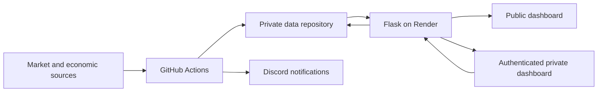

# StockAlerts

StockAlerts is a personal stock-monitoring and portfolio dashboard built with Python, Flask, GitHub Actions, and Discord. It brings portfolio performance, watchlist targets, valuation metrics, trade records, and market context into a public dashboard and a password-protected private dashboard.

**[Open the public dashboard](https://stock-alerts-9w0q.onrender.com/public)** · **[Private dashboard](https://stock-alerts-9w0q.onrender.com/)** · **[GitHub Actions](https://github.com/MarkKondoskal/stock-alerts/actions)**

Alerts are notifications. Recording a trade updates the project’s records; it does not place an order with a broker.

## Dashboards

### Holdings and performance

- Combined, US/Merrill, and DK/Nordnet account views.
- USD and DKK display currencies, with ETF inclusion/exclusion controls.
- Portfolio performance compared with SPY over matching dates.
- Holdings and sector allocations based on available market values.
- Biggest gainers and losers by individual stock-price return.
- **Performance Drivers** below the gainers chart: up to five contributors and five detractors, based on historical holdings, including sold positions.
- Quote dates, history dates, and missing-data indicators.

Performance Drivers follows the gainers-period selection and the shared account, currency, and ETF filters. Contributions are measured in **percentage points (pp)** of portfolio return. For example, a stock worth 10% of a portfolio that rises 20% contributes approximately **+2 pp**, assuming a constant weight. The implementation links daily historical contributions as holdings and weights change.

### Watchlist and alerts

Each row shows **latest price → valuation → target proximity → configured targets**.

- Latest available quote, currency, and observation time when provided.
- Trailing P/E, forward P/E (`FxPE`), and price/sales (`P/S`).
- Multiple price and valuation targets per ticker.
- Percentage rise or fall needed to reach each target.
- Amber **Near** labels for unmet targets within 5%; green **Condition met** labels when the displayed value satisfies the rule.
- Sorting by ticker or closest target.
- Expandable target editing on the private dashboard; public watchlists are read-only.

### Private tools

- Position quantities, market values, cost basis, and available realized/unrealized P/L.
- Explicit partial-valuation labels when prices are missing.
- Trade Manager for completed BUY, SELL, and SPLIT events, including supported fees and fee-currency conversion.
- Request IDs to protect against duplicate trade submissions after uncertain responses.
- Supported manual-trade corrections with replay of later manual entries and an audit record.
- Trade journal notes, private by default, with optional public sharing.
- Private stock-alert history showing notification attempts and delivery outcomes.
- System Health with workflow history, last successful runs, data freshness, and approved manual workflow dispatch.

### Market context

The Sentiment view includes VIX, Fear & Greed, economic readings, and an economic calendar. Data-source availability and cached readings are labelled. Background workflows also support portfolio earnings reports, economic alerts, and a weekday market-open heartbeat through Discord.

## Architecture and privacy

The project uses two repositories:

| Repository | Responsibility |
|---|---|
| `stock-alerts` | Public application source, web assets, alert scripts, tests, and application workflows |
| `stock-alerts-private-data` | Private account records, transaction ledgers, watchlist state, alert history, calculations, and generated performance data |



The server reads private files using a server-side GitHub token. Public endpoints return selected fields rather than raw account documents.

- Public holdings expose tickers and allocation percentages, not quantities or account values.
- Public Trade Activity intentionally exposes selected buy/sell information, including dates and permitted position-change bands. Journal notes are shared only when published.
- Private quantities, money values, complete transaction records, and unpublished notes require authentication.
- GitHub tokens, dashboard passwords, FRED keys, and Discord webhook URLs belong in environment variables or service secrets.

**The prepared dashboard bundle contains private financial data. Keep it in the private repository; never copy it into `web/static/` or another public asset location.**

The dashboard uses a shared password. It is intended as a personal tool deployed behind HTTPS, rather than a multi-user account system.

## How alerts work

| Metric | Direction | Trigger |
|---|---|---|
| Price | Downside target | The current exchange-local session’s low is at or below the target |
| Forward P/E, P/E, P/S | BUY | Available positive multiple is at or below the target |
| Forward P/E, P/E, P/S | TRIM | Available positive multiple is at or above the target |

Targets are thresholds, not crossing-event subscriptions. For example, a valuation already below a BUY target can trigger on the next scan. `BUY` and `TRIM` describe notification conditions, not brokerage instructions.

The website calculates proximity from the displayed latest price or multiple:

```text
Percentage move to target = (target / observed value - 1) × 100
```

A price alert can trigger on the session low even if the displayed latest price has since rebounded. A website label of “Condition met” is not proof that Discord accepted a message or that the target was removed.

Missing, negative, or non-finite valuation multiples are unavailable and do not trigger valuation targets. Tickers and numeric targets are validated consistently across the editor and alert tools.

After Discord accepts an alert, the scanner removes its target locally and the workflow publishes the update to the private repository. Failed or unconfirmed deliveries retain the target for retry. Revision-checked writes merge individual workflow target changes; outdated dashboard edits are rejected with a conflict.

### Alert history and delivery limits

The private Watchlist & Alerts view displays the latest 200 stock-alert attempts; up to 1,000 are retained in `alerts/alert_history.json`. It distinguishes pending, accepted, and failed/uncertain deliveries. Earlier messages are not backfilled, and this journal does not cover every sentiment, earnings, or economic notification.

Discord delivery and repository persistence are separate operations. An interrupted runner or an uncertain network response can cause incomplete history or duplicate notifications. The set-based watchlist cannot distinguish removal and re-addition of an identical target during a concurrent edit. Exactly-once delivery is not guaranteed.

## Setup

### 1. Prepare the private data repository

Keep account data in a private repository accessible to the application and workflows. Main paths are:

```text
alerts/
  watchlist.json
  alert_history.json             # Created when stock-alert attempts are recorded
portfolio/
  merrill_portfolio.json
  nordnet_portfolio.json
  marks_portfolio.json            # Legacy portfolio/earnings workflows
  calculations/
  performance/                   # Generated histories, summaries, attribution CSVs
  dashboard_snapshot.json        # Generated private dashboard bundle
```

Import and reconcile real account records before running portfolio calculations. The public application’s synthetic test fixtures are examples for tests, not portfolio imports.

The legacy `marks_portfolio.json` model remains separate from the Merrill/Nordnet account files. The legacy Marks Portfolio Manager does not update account-specific Trade Manager records.

### 2. Configure GitHub Actions

In the **code repository**, open **Settings → Secrets and variables → Actions**.

| Type | Name | Purpose |
|---|---|---|
| Variable | `STOCKALERTS_DATA_REPOSITORY` | Private repository as `OWNER/REPOSITORY` |
| Variable | `STOCKALERTS_DATA_BRANCH` | Private branch; defaults to `main` |
| Secret | `STOCKALERTS_DATA_TOKEN` | Token with Contents read/write access to the selected private repository |
| Secret | `DISCORD_STOCK_WEBHOOK` | Stock notifications and workflow watchlist status posts |
| Secret | `DISCORD_SENTIMENT_WEBHOOK` | Sentiment notifications; also used by the economic-alert workflow |
| Secret | `DISCORD_PORTFOLIO_WEBHOOK` | Legacy portfolio and earnings notifications |
| Secret | `DISCORD_PORTFOLIO_TEST_WEBHOOK` | Market-open heartbeat |
| Secret | `FRED_API_KEY` | FRED access for the economic-monitor workflow |

Configure only the notification workflows you intend to use. For local Watchlist Manager runs, `DISCORD_WATCHLIST_WEBHOOK` can override the stock webhook.

Allow workflow writes where generated state is committed, subject to repository and branch-protection policies. The private repository’s own performance workflow must be able to publish generated files to its configured branch.

### 3. Run the web app locally

Use Python 3.11 and install the application dependencies. From the repository root in PowerShell:

```powershell
python -m venv web/.venv
.\web\.venv\Scripts\Activate.ps1
python -m pip install -r web/requirements.txt
Copy-Item web/.env.example web/.env
```

Edit `web/.env` with your own settings:

```dotenv
DASHBOARD_PASSWORD=your-long-unique-password
GITHUB_TOKEN=your-repository-scoped-token
GITHUB_REPOSITORY=OWNER/stock-alerts
GITHUB_BRANCH=main
GITHUB_DATA_REPOSITORY=OWNER/stock-alerts-private-data
GITHUB_DATA_BRANCH=main
DISCORD_STOCK_WEBHOOK=
FRED_API_KEY=
```

The web token needs private Contents access for reads/writes and Actions access for the repositories whose runs it reads or workflows it dispatches. Dispatching private portfolio recalculation requires Actions write access to the private repository. Limit access to the required repositories.

`DISCORD_STOCK_WEBHOOK` enables the web dashboard’s real Discord test. `FRED_API_KEY` enables supported server-side economic readings; it must be configured separately on Render even if the GitHub Actions secret already exists.

```powershell
python web/app.py
```

Open `http://127.0.0.1:8000/public` for the public view or `http://127.0.0.1:8000/` for the private login. Local `.env` files are ignored by Git; hosting environment variables take precedence.

### 4. Deploy on Render

Create or configure a Python web service from the code repository. With the repository root as the service root, use:

```text
Build command: pip install -r web/requirements.txt
Start command: gunicorn --chdir web --bind 0.0.0.0:$PORT app:app
```

Set the web environment variables above in Render’s environment settings. Use HTTPS and keep secrets out of browser code. The app requires a Python server; GitHub Pages alone cannot run its authenticated API.

### 5. Initialize generated data

1. Run **Daily Portfolio Performance** in the private repository and confirm the histories and attribution files were generated successfully.
2. Run **Prepare dashboard snapshots** in the code repository.
3. Open the dashboard and check quote dates, performance dates, and System Health.
4. Run notification workflows manually when ready; these can send actual Discord messages.

The initial snapshot run is important after installation, especially on weekends when its automatic schedule is inactive.

## Workflows

Application definitions are in [`.github/workflows/`](.github/workflows/). Scheduled times are UTC unless noted; GitHub schedules can be delayed.

| Workflow | Schedule / trigger | Responsibility |
|---|---|---|
| Stock & Sentiment Alert Pipeline | Every 15 minutes, 07:00–21:59 UTC, Monday–Friday; manual | Scan targets, preserve attempt history, publish target changes, run sentiment checks |
| Prepare dashboard snapshots | Hourly at minute 7, 07:00–23:00 UTC, Monday–Friday; manual | Prepare dashboard and watchlist market data |
| Watchlist Manager | Manual | Add/remove/list targets or post Discord status |
| Portfolio Earnings Report | Hourly; manual | Report available portfolio earnings using legacy portfolio records |
| US Economic Data Monitor | Hourly, Monday–Friday; manual | Check economic readings and FOMC information |
| US Market Open Heartbeat | Weekdays at 09:30 America/New_York; manual | Send a Discord heartbeat; not an exchange-holiday calendar |
| Marks Portfolio Manager | Manual | Maintain the separate legacy portfolio model |
| Application regression tests | Pushes and pull requests | Run Python and JavaScript tests without production secrets |
| Daily Portfolio Performance *(private repository)* | 23:15 UTC, Monday–Friday; manual | Rebuild account/combined histories and attribution inputs |

## Managing targets

Use the private **Watchlist & Alerts** editor, or select **Actions → Watchlist Manager → Run workflow**.

Supported actions are `ADD`, `REMOVE`, `REMOVE_ALL`, `LIST`, and `STATUS`. Metrics are `PRICE`, `FxPE`, `PE`, and `P/S`. Direction applies to valuation rules; price targets always use the downside condition.

Example private watchlist:

```json
{
  "MA": {
    "price_targets": [300],
    "valuation_targets": {
      "FxPE": {"buy": [25], "trim": [35]},
      "P/S": {"buy": [5], "trim": []}
    }
  }
}
```

For local CLI use, set `STOCKALERTS_WATCHLIST_FILE` to your private checkout’s watchlist, then run from the code repository root:

```powershell
$env:STOCKALERTS_WATCHLIST_FILE = "C:\path\to\private-repo\alerts\watchlist.json"
python alerts/watchlist_manager.py LIST
python alerts/watchlist_manager.py ADD MA 25 FxPE BUY
python alerts/watchlist_manager.py ADD MA 35 FxPE TRIM
python alerts/watchlist_manager.py REMOVE MA 25 FxPE BUY
```

`STATUS` sends a real Discord message and requires a webhook. Local scanner runs require a stock webhook; set `STOCKALERTS_ALERT_HISTORY_FILE` to a private path if you also want local attempt recording. Legacy portfolio scripts use `LEGACY_PORTFOLIO_FILE` for their private data path.

## Data freshness and calculation limits

### Prepared data

Background preparation reduces market-data work during page requests. Snapshots are stored in the private repository and cover account, currency, ETF, and period selections. Account fingerprints reject prepared holdings/analytics after the source account records change.

- Prepared data normally expires after two hours; the weekend/Monday-before-07:00 UTC allowance is 96 hours.
- Holdings/analytics fall back to existing calculations when prepared results are missing or expired.
- New watchlist tickers show unavailable market data until a successful preparation includes them.
- **Refresh data reloads available data; it does not necessarily fetch a fresh market quote.** The quote timestamp describes the observation, not the time the page opened.
- Prepared snapshots reduce repeated work but do not eliminate Render cold starts, GitHub latency, or upstream outages.

### Performance methodology

Returns are **provisional invested-securities returns**, not audited brokerage account returns. They use dated holdings and daily prices, with trades assumed effective at the end of the trade date.

Important limitations include excluded idle cash and cash dividends, incomplete historical reinvestments/fractional shares, trading-fee exclusions in the historical return series, and the explicit Adobe exclusion in relevant US/combined histories. Corporate actions require reconciliation. Selected-currency views include the implemented USD/DKK conversion; this may differ from a broker’s execution or valuation conventions. SPY comparisons use price returns rather than dividend-reinvested total returns.

Trade Manager can include recorded fees in position cost basis even though the historical performance series does not represent a complete fee-adjusted account return. Open-position costs and available realized amounts translated using latest FX are indicative values, not tax-lot accounting or tax statements.

Performance Drivers inherits these limitations. Missing attribution intervals or a contribution total differing from the displayed return by more than 0.05 pp suppresses the chart until matching inputs are available. Displayed top/bottom bars are a subset of all contributors and need not sum to the total portfolio return.

The price scanner requires a bar dated to the current exchange-local session. Missing current-session data fails conservatively for active price targets, including possible pre-market or holiday cases; an empty watchlist is a successful no-op. Exchange-calendar classification is not implemented.

## Tests

From the code repository root, with Python dependencies installed and Node.js available:

```powershell
python -m unittest discover -s tests -v
node --test tests/watchlist_render.test.cjs tests/drivers_ui.test.cjs
```

CI runs all `tests/*.test.cjs` files. Tests use mocked services and synthetic account fixtures by default; they do not place trades or require production credentials. For additional checks using your private records, set `STOCKALERTS_TEST_ACCOUNT_DIR` to the private `portfolio` directory.

From the private data repository root:

```powershell
python -m unittest discover -s portfolio/tests -v
```

Offline tests verify implementation behaviour; they do not prove live provider availability, deployed permissions, notification receipt, or broker reconciliation.

## Troubleshooting

| Symptom | Check |
|---|---|
| Watchlist prices say unavailable | Run **Prepare dashboard snapshots**; inspect its log and quote timestamps. A newly added ticker needs preparation. |
| Performance Drivers is empty | Check attribution coverage, selected dates/currency/ETF mode, and the private performance workflow. Reconciliation failures are deliberately visible. |
| Save reports a conflict | Reload the latest watchlist/account state and reapply the intended edit. |
| No Discord alert | Check the target condition, source-data availability, webhook secret, workflow result, and private attempt history. |
| Price-alert workflow fails before opening | No current-session bar may be available; inspect the log rather than assuming the target was checked. |
| Economic readings are cached or unavailable | Configure `FRED_API_KEY` separately for Render and Actions; inspect source/schedule warnings. |
| Holdings update but history lags | Run the private **Daily Portfolio Performance** workflow, then prepare dashboards again. |
| First page load is slow | Check service cold-start behaviour and whether usable prepared data is available. |

## Project layout

```text
.github/workflows/       Application schedules, manual actions, and CI
.github/scripts/         Supporting Git state-publishing scripts
alerts/                  Stock, sentiment, economic, heartbeat, and preparation tools
portfolio/               Legacy portfolio and earnings scripts
web/                     Flask API, projections, analytics, and deployment dependencies
web/static/              Public/private pages, styles, charts, and shared renderers
tests/                   Offline regressions and synthetic fixtures
watchlist_rules.py       Shared watchlist validation
```

See [`web/.env.example`](web/.env.example) and the [workflow definitions](.github/workflows/) for the configuration consumed by the current code.

## Disclaimer

StockAlerts is a personal monitoring and record-keeping project for informational purposes. Data may be delayed, missing, or revised. Independently verify information before making investment decisions.
